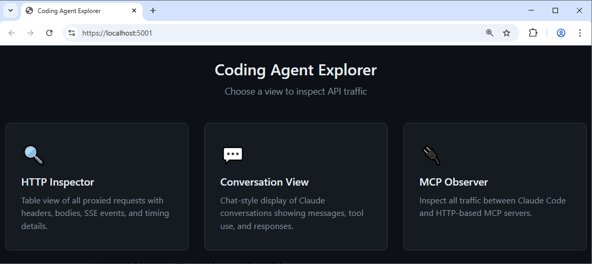
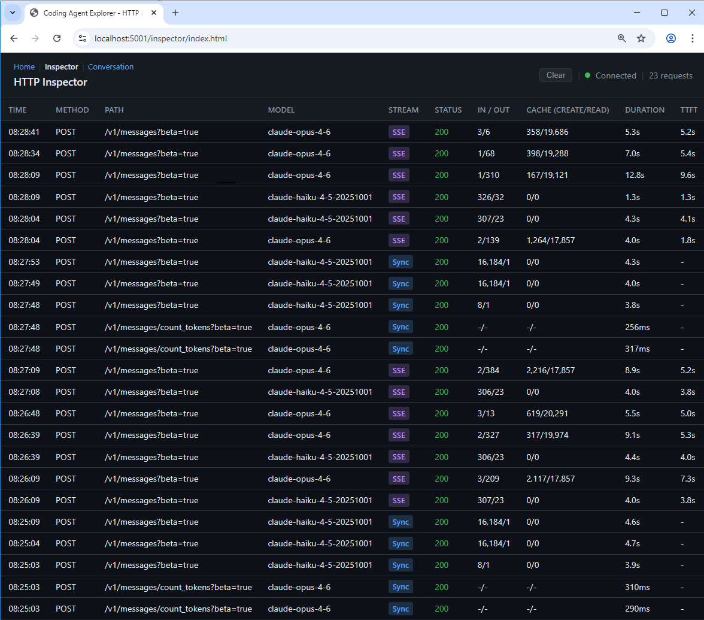
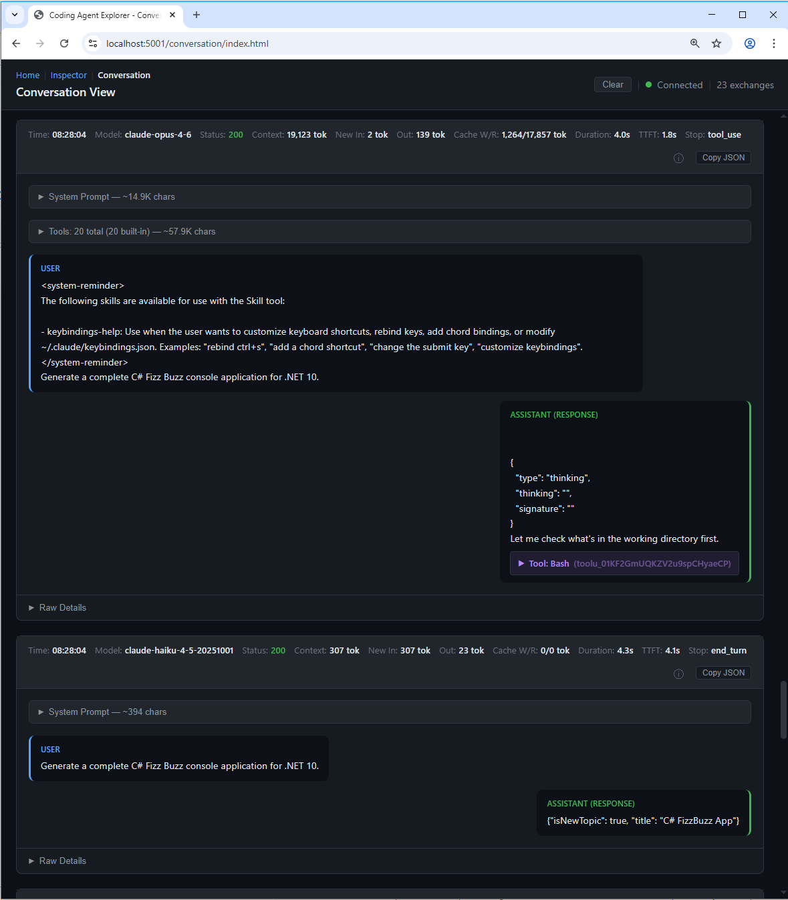
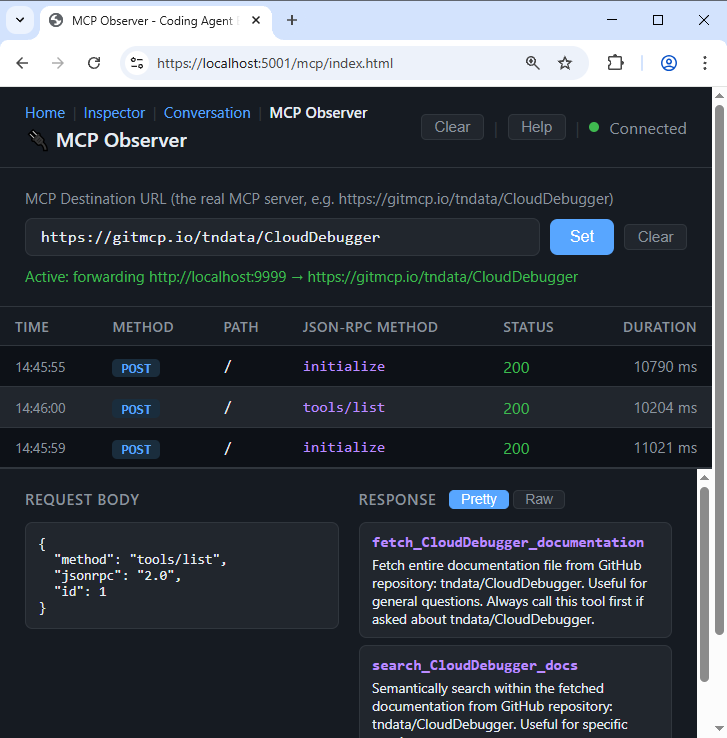
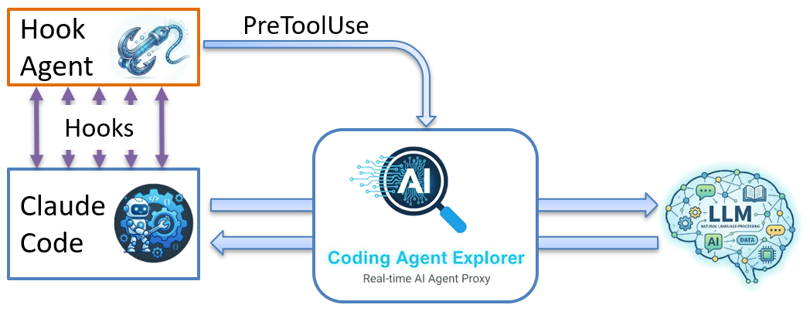
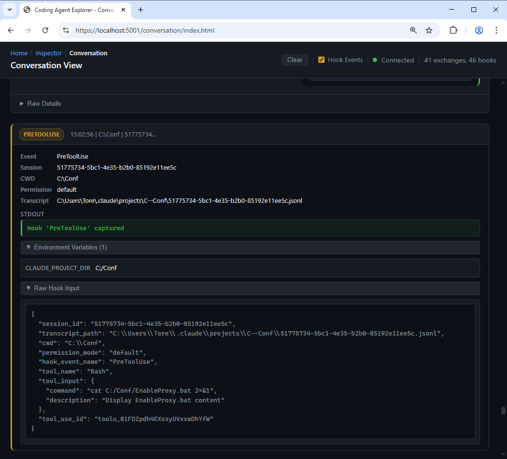

# Coding Agent Explorer

A real-time .NET proxy and dashboard for inspecting Claude Code API calls. Intercept, visualize, and analyze every request and response between Claude Code and the Anthropic API.

With Coding Agent Explorer, you can:

- See every API request and response between Claude Code and the Anthropic API in real time
- Inspect full request/response headers, bodies, and streaming SSE events
- Track token usage, model selection, and time-to-first-token
- Follow the conversation as a readable chat-style timeline
- Capture and inspect MCP tool calls between Claude Code and HTTP-based MCP servers
- Monitor Claude Code hook events alongside API traffic
- Switch the dashboard between light and dark themes, with your choice remembered across sessions


## Dashboard

The dashboard offers three views for inspecting your coding agent's activity: HTTP Inspector, Conversation View, and MCP Observer.



## HTTP Inspector

Every API request and response is captured and displayed in a table with full headers, request and response bodies, streaming SSE events, token usage, and timing details.



## Conversation View

The Conversation View renders the raw API traffic as a readable chat-style timeline, showing messages, tool calls, responses, and hook events in the order they occurred.



## MCP Observer

The MCP Observer acts as a proxy between Claude Code and any HTTP-based MCP server. Configure the destination URL and all MCP traffic is captured and displayed in real time. The MCP Observer will be covered in a future blog post.



## Read More

Want to learn more about this project? Check out the blog posts:

- [Introducing the Coding Agent Explorer .NET](https://nestenius.se/ai/introducing-the-coding-agent-explorer-net/)
- [Exploring Claude Code Hooks with the Coding Agent Explorer (.NET)](https://nestenius.se/ai/exploring-claude-code-hooks-with-the-coding-agent-explorer-net/)
- [Visualizing Claude Code MCP Requests with Coding Agent Explorer](https://nestenius.se/ai/visualizing-claude-code-mcp-requests-with-coding-agent-explorer/)

## Prerequisites

- [.NET 10 SDK](https://dotnet.microsoft.com/download) or later

## Getting Started

### 1. Install .NET 10 SDK

Download and install the [.NET 10 SDK](https://dotnet.microsoft.com/download) if you do not already have it.

### 2. Clone the repository

```bash
git clone https://github.com/tndata/CodingAgentExplorer.git
cd CodingAgentExplorer
```

### 3. Build and run

```bash
dotnet build
dotnet run --project CodingAgentExplorer
```

This starts four endpoints:
- **Port 8888** - The reverse proxy (HTTP, point your coding agent here)
- **Port 9999** - The MCP proxy (HTTP, used by the MCP Observer)
- **Port 5000** - The web dashboard (HTTP)
- **Port 5001** - The web dashboard (HTTPS, auto-launches in browser)

### 4. Configure your coding agent

For **Claude Code**, set the `ANTHROPIC_BASE_URL` environment variable to point at the proxy.

**Linux / macOS:**

Use `source` (not `bash`) so the variable is exported to your current shell:

```bash
source EnableProxy.sh
```

Run `source DisableProxy.sh` to clear it when you are done.

**Windows (cmd):**

```bat
EnableProxy.bat
```

Run `DisableProxy.bat` to clear it.

**Windows (PowerShell):**

```powershell
# Enable
$env:ANTHROPIC_BASE_URL = "http://localhost:8888"
$env:CLAUDE_CODE_GATEWAY_HINT_HEADERS = "1"

# Disable
Remove-Item Env:ANTHROPIC_BASE_URL
Remove-Item Env:CLAUDE_CODE_GATEWAY_HINT_HEADERS
```

The scripts also set `CLAUDE_CODE_GATEWAY_HINT_HEADERS=1`. Claude Code sends extra `x-claude-code-*` request headers (request class: main, subagent or auxiliary; agent type; prompt id; tool durations) when it talks to `api.anthropic.com` directly, but not through a custom `ANTHROPIC_BASE_URL` unless this variable is set. With it, the proxy sees the same headers as a direct session.

All scripts only affect the current terminal session. The variables are not persisted, so closing the terminal automatically clears them.

Then use Claude Code as you normally would.

### 5. Open the dashboard

Navigate to [https://localhost:5001](https://localhost:5001) in your browser. On Windows the browser opens automatically on `dotnet run`. On macOS and Linux, open it manually.

You will see three views and a settings page:

- **HTTP Inspector** - Table view of all proxied requests with headers, bodies, SSE events, and timing details
- **Conversation View** - Chat-style display showing messages, tool use, and responses
- **MCP Observer** - Dedicated view for inspecting MCP server traffic (see below)
- **Settings** - Where the proxy on port 8888 sends requests (see below)

## Changing the API upstream (optional)

By default the proxy on port 8888 forwards to `https://api.anthropic.com`. You can point it at any other server that speaks the Anthropic Messages API, for example a local model in [LM Studio](https://lmstudio.ai/), which has an Anthropic-compatible endpoint. The proxy forwards requests as they are and translates nothing, so an OpenAI-only server will not work.

The upstream is chosen in this order:

1. **The Settings page** in the dashboard, for the current run only. **Reset** goes back to the startup value.
2. **The environment variable** `CODING_AGENT_EXPLORER_UPSTREAM_URL`, set before you start the app:
   ```powershell
   $env:CODING_AGENT_EXPLORER_UPSTREAM_URL = "http://localhost:1234"
   ```
3. **`appsettings.json`**, the `ApiUpstream:Url` setting.
4. **The default**, `https://api.anthropic.com`.

The console shows the upstream in use at startup, and the Settings page shows it at any time. An invalid URL in the variable or in `appsettings.json` stops the app at startup with an error, instead of silently falling back to Anthropic. A path in the URL is kept (`https://gateway.example.com/anthropic` sends `/v1/messages` to `/anthropic/v1/messages`).

The proxy passes on whatever credentials Claude Code sends, so the upstream receives your API key or login token. Only point it at servers you trust.

When Claude Code talks to a local model, start it with that model's name, for example `claude --model qwen3-coder-30b-a3b-instruct-mlx`. The configurable upstream was contributed by [Marek Kacprzak](https://github.com/marekkacprzak).

## MCP Observer

The MCP Observer lets you intercept and inspect traffic between Claude Code and any [Model Context Protocol (MCP)](https://modelcontextprotocol.io/) server. It acts as a transparent proxy on port 9999, sitting between Claude Code and the real MCP server.

```
Claude Code  --►  MCP Observer (port 9999)  --►  Real MCP Server
                         |
                         ▼
                  Dashboard (port 5000/5001)
```

### What it shows

- Every MCP request and response in real time, sorted chronologically
- The JSON-RPC method for each request (`initialize`, `tools/list`, `tools/call`, etc.)
- For `tools/call`, the specific tool name is shown inline, e.g. `tools/call (query-docs)`
- A Pretty view that renders responses in a readable format per method type:
  - `tools/list` - one card per tool with name, description, and parameters
  - `initialize` - protocol version, server name, and capabilities
  - `tools/call` - the returned content rendered directly
- A Raw view with pretty-printed JSON for all other responses
- Request and response bodies side by side

### Setup

**Step 1:** Open the MCP Observer at [https://localhost:5001/mcp/index.html](https://localhost:5001/mcp/index.html).

**Step 2:** Enter the URL of the real MCP server in the destination field and click Set.

**Step 3:** Register the proxy as an MCP server in Claude Code:

```bash
claude mcp add --transport http mcp_proxy http://localhost:9999
```

Claude Code will now route all MCP traffic through the observer. To remove it later:

```bash
claude mcp remove mcp_proxy
```

### Sample MCP services to try

| Service | URL | Sample prompt |
|---------|-----|---------------|
| Microsoft Learn | `https://learn.microsoft.com/api/mcp` | "How do I create an Azure Container App using az cli?" |
| Context7 | `https://mcp.context7.com/mcp` | "How do I set up middleware in Next.js 15? use context7" |

## Publishing

Run the publish script from the repo root to build release artifacts into `Published/` (gitignored). Each script builds both projects for the current platform.

**Windows:**
```bat
publish.bat
```

| Output | Description |
|--------|-------------|
| `Published\CodingAgentExplorer\` | Proxy + dashboard (exe, wwwroot, appsettings.json) |
| `Published\HookAgent\HookAgent.exe` | HookAgent (win-x64, single-file) |

**macOS / Linux:**
```bash
bash publish.sh
```

| Output | Description |
|--------|-------------|
| `Published/CodingAgentExplorer/` | Proxy + dashboard (exe, wwwroot, appsettings.json) |
| `Published/HookAgent/HookAgent` | HookAgent (current platform, single-file) |

All outputs require the .NET 10 runtime on the target machine. To use HookAgent as a Claude Code hook command, see [HookAgent](#hookagent).

## Demo folder (Windows)

`SetupDemoFolder.bat` builds a ready-to-use demo folder in one step, so a demo or a talk starts from the same clean state every time. It:

1. runs `publish.bat`,
2. creates `C:\Conf` (it must be missing or empty, nothing is ever deleted),
3. copies in `EnableProxy.bat`, `HookAgent\HookAgent.exe` and `.pdb`, the Windows sample `.claude\settings.json`, and the sample skill from `DemoFolder\skills\Sweden\`.

```bat
SetupDemoFolder.bat
```

The folder is always `C:\Conf`. If it already exists and is not empty, the script stops and asks you to clear it first, so to run it again, empty or delete `C:\Conf` yourself.

Then open a command prompt in the demo folder, run `EnableProxy.bat` and start `claude`.

## HookAgent

HookAgent is a small companion CLI tool that acts as a [Claude Code hook](https://code.claude.com/docs/en/hooks) command. It bridges Claude Code's hook system and the CodingAgentExplorer dashboard, letting you see every hook event (session start/end, tool calls, permission requests, notifications, and more) appear in the conversation view in real time.

> Read more: [Exploring Claude Code Hooks with the Coding Agent Explorer (.NET)](https://nestenius.se/ai/exploring-claude-code-hooks-with-the-coding-agent-explorer-net/)

### How it works



Claude Code invokes hook commands by writing a JSON payload to **stdin** and reading the exit code and stdout/stderr on completion. HookAgent:

1. Reads the JSON payload from stdin
2. Collects Claude Code environment variables (`CLAUDE_PROJECT_DIR`, `CLAUDE_ENV_FILE`, etc.)
3. POSTs everything to the dashboard at `http://localhost:5000/api/hook-event`
4. Relays the server's `exitCode`, `stdout`, and `stderr` back to Claude Code
5. Exits silently with code 0 if the dashboard is not running, so it never blocks Claude Code

### Setup on Windows

**Step 1:** Run `publish.bat` to build both projects.

**Step 2:** Put `HookAgent.exe` where Claude Code can run it. Pick one:

- **In the project (simplest):** copy `Published\HookAgent\` into the working directory where you run `claude`, as shown below. The sample settings already point to `HookAgent/HookAgent.exe`.
- **One fixed location:** copy `Published\HookAgent\` once to a folder such as `C:\Tools\HookAgent\`, and change every `command` in `.claude\settings.json` to the full path, for example `C:/Tools/HookAgent/HookAgent.exe`. You then need no copy per project.

```
C:\MyProject\
  HookAgent\
    HookAgent.exe
  .claude\
    settings.json
```

**Step 3:** Copy `HookAgent\Sample-Settings-Windows\settings.json` from the repo to `.claude\settings.json` in the working directory. This registers HookAgent for 30 of the 33 Claude Code hook events (see [Hook events captured](#hook-events-captured)).

**Step 4:** Start CodingAgentExplorer, then run `claude` from the working directory. Hook events appear in the Conversation View alongside API requests.

> **Note:** On Windows, Claude Code runs hook commands with Git Bash, or with PowerShell when Git Bash is not installed. Forward slashes in the command path work in both: `HookAgent/HookAgent.exe`.

### Setup on macOS / Linux

**Step 1:** Run `bash publish.sh` to build both projects for your platform.

**Step 2:** Put `HookAgent` where Claude Code can run it. Pick one:

- **In the project (simplest):** copy `Published/HookAgent/` into the working directory where you run `claude`, as shown below. The sample settings already point to `HookAgent/HookAgent`.
- **One fixed location:** copy `Published/HookAgent/` once to a folder such as `/opt/hookagent/`, and change every `command` in `.claude/settings.json` to the full path, for example `/opt/hookagent/HookAgent`. You then need no copy per project.

```
~/MyProject/
  HookAgent/
    HookAgent
  .claude/
    settings.json
```

**Step 3:** Copy `HookAgent/Sample-Settings-LinuxMacOS/settings.json` from the repo to `.claude/settings.json` in the working directory. This registers HookAgent for 30 of the 33 Claude Code hook events (see [Hook events captured](#hook-events-captured)).

**Step 4:** Start CodingAgentExplorer, then run `claude` from the working directory. Hook events appear in the Conversation View alongside API requests.

### Assumptions in the sample settings

The sample `settings.json` files assume the following. Change the file if your setup differs.

- **The command path is relative.** `HookAgent/HookAgent.exe` (`HookAgent/HookAgent` on macOS and Linux) is resolved from the folder where you start `claude`. Start it from another folder, or put HookAgent somewhere else, and the hooks silently do nothing until you use a full path.
- **The dashboard runs at `http://localhost:5000`.** That address is built into HookAgent. If the dashboard is not running, HookAgent exits silently with code 0 and Claude Code carries on.
- **Hooks run synchronously** (`"async": false`), so Claude Code waits for HookAgent on each event. Only `MessageDisplay` is async, because it fires while text streams. Add `"async": true` to any entry if you only observe and do not need exact ordering.
- **Tool events match every tool** (`"matcher": ".*"`). Narrow the matcher to watch only some tools.
- **30 of the 33 hook events are registered**, as of Claude Code 2.1.318. `WorktreeCreate` and `WorktreeRemove` are left out because a hook for them replaces git's own worktree handling, and `FileChanged` is left out because it needs literal file names as matchers. If your Claude Code version does not know an event, remove its entry.
- **On Windows, Claude Code runs hook commands with Git Bash,** or with PowerShell when Git Bash is not installed. Forward slashes in the command path work in both.
### Verify it works

Test HookAgent manually before starting a Claude Code session:

```bash
echo '{"hook_event_name":"UserPromptSubmit","session_id":"test"}' | HookAgent/HookAgent.exe
```

If the dashboard is running, a `UserPromptSubmit` event appears in the Conversation View immediately. If the dashboard is not running, the command exits silently with code 0.

### Example



Hook events appear inline in the Conversation View, interleaved with API requests in chronological order. Each event shows the event type, timestamp, session, and any stdout returned by the dashboard.

### Hook events captured

| Event | When it fires |
|---|---|
| `SessionStart` / `SessionEnd` | Claude Code session begins or resumes / terminates |
| `Setup` | `--init-only`, or `--init` / `--maintenance` with `-p` |
| `UserPromptSubmit` | User submits a prompt |
| `UserPromptExpansion` | A typed command expands into a prompt |
| `PreToolUse` | Before any tool call executes |
| `PermissionRequest` / `PermissionDenied` | Claude Code asks for permission / auto mode denies a tool call |
| `PostToolUse` / `PostToolUseFailure` | After a tool call succeeds / fails |
| `PostToolBatch` | After a batch of parallel tool calls, before the next model call |
| `MessageDisplay` | While assistant text is displayed (runs with `async: true`) |
| `Stop` / `StopFailure` | Claude finishes responding / the turn ends on an API error |
| `SubagentStart` / `SubagentStop` | A subagent is spawned or finishes |
| `TaskCreated` / `TaskCompleted` / `TeammateIdle` | Task and agent team events |
| `Notification` | Claude Code sends a notification |
| `PreCompact` / `PostCompact` | Before / after context compaction |
| `PreModelSwitch` / `PostModelSwitch` | Before / after the model changes |
| `InstructionsLoaded` | A `CLAUDE.md` file or rule is loaded into context |
| `ConfigChange` | A settings file changes during the session |
| `CwdChanged` / `DirectoryAdded` | The working directory changes / `/add-dir` adds a directory |
| `Elicitation` / `ElicitationResult` | An MCP server asks for user input / the user answered |

Three events are left out on purpose. `WorktreeCreate` and `WorktreeRemove` replace git's own worktree handling, so a hook that only observes would break worktree creation. `FileChanged` needs literal file names as matchers, so one catch-all entry makes no sense. The list matches Claude Code 2.1.318; if your version does not know an event, remove its entry from `settings.json`. All hooks run synchronously (`async: false`) so the order in the timeline is exact, except `MessageDisplay`, which fires while text streams and runs in the background. For pure observation you can set `async: true` on any entry.

## Architecture

```
  Coding Agent  ──►  CodingAgentExplorer (port 8888)  ──►  LLM API
                            │
                            ▼
                     Web Dashboard (port 5000/5001)
                     Real-time via SignalR
```

- ASP.NET Core with [YARP](https://github.com/dotnet/yarp) reverse proxy
- SignalR for real-time dashboard updates
- Vanilla HTML/JS/CSS frontend (no build step required)
- Single NuGet dependency (`Yarp.ReverseProxy`)

## Project Structure

```
├── publish.bat                         # Publishes both projects to Published/ (Windows, win-x64)
├── publish.sh                          # Publishes both projects to Published/ (all platforms)
├── SetupDemoFolder.bat                 # Creates a clean demo folder, C:\Conf (Windows)
├── DemoFolder/                         # Sample skill copied into the demo folder
├── CodingAgentExplorer/
│   ├── Program.cs                      # App setup: YARP, SignalR, dual-port Kestrel
│   ├── Models/                         # DTOs: ProxiedRequest, ClaudeRequestBody, SseEvent, HookEvent
│   ├── Services/RequestStore.cs        # In-memory circular buffer (max 1000 requests)
│   ├── Services/HookEventStore.cs      # In-memory store for hook events
│   ├── Services/McpRequestStore.cs     # In-memory store for MCP requests
│   ├── Services/McpProxyConfig.cs      # Holds the configured MCP destination URL
│   ├── Services/ApiUpstreamConfig.cs   # Where port 8888 forwards to (startup value and Settings override)
│   ├── Services/DashboardRequestGuard.cs  # Only the dashboard may change the settings endpoints
│   ├── Proxy/CaptureTransformProvider.cs  # YARP ITransformProvider for request/response capture
│   ├── Proxy/DynamicProxyConfigProvider.cs # Dynamic YARP config for Claude (8888) and MCP (9999) routes
│   ├── Hubs/DashboardHub.cs            # SignalR hub for real-time dashboard updates
│   └── wwwroot/                        # Dashboard SPA (vanilla HTML/JS/CSS)
│       ├── index.html                  # Landing page with view selection
│       ├── inspector/                  # HTTP Inspector view
│       ├── conversation/               # Conversation view
│       ├── mcp/                        # MCP Observer view
│       ├── settings/                   # Settings page (API upstream)
│       ├── css/                        # Stylesheets
│       └── js/                         # Dashboard and conversation scripts
└── HookAgent/                          # Single-file CLI tool for Claude Code hooks
```


## Security

- API keys (`x-api-key` and `Authorization` headers) are automatically redacted from stored request data
- The proxy only listens on `localhost` - it is not exposed to the network
- The settings endpoints (API upstream and MCP destination) decide where your credentials go, so they only accept requests with a `localhost` Host header and, from a browser, only from the dashboard itself. This blocks other web pages, including DNS rebinding tricks, from changing them
- Request data is stored in memory only (max 1000 requests, no persistence)

## About the author

This tool was developed by [Tore Nestenius](https://nestenius.se/), a Microsoft .NET MVP and independent 
consultant and trainer from Göteborg, Sweden, specializing in authentication, identity and security in .NET.

* [LinkedIn](https://www.linkedin.com/in/torenestenius/)
* [Blog](https://nestenius.se/)
* [Company](https://tn-data.se/)


## Other Projects by the Author

- [CloudDebugger](https://github.com/tndata/CloudDebugger) - A .NET web application designed to explore and learn about various Azure services and features, including authentication, configuration, networking, and more.

## Want to learn more about AI agents?

Coding Agent Explorer was built as a teaching tool for Tore Nestenius' talk [How Coding Agents Actually Work: Tools, MCP, and the Agent Loop](https://tn-data.se/talks/ai-development/), which he has given more than ten times. It helps developers see what happens under the hood when an AI coding agent works.

Would you like the talk at your conference, user group or company? [Get in touch](https://tn-data.se/contact/). If you prefer to read first, start with the blog post [Introducing the Coding Agent Explorer (.NET)](https://nestenius.se/ai/introducing-the-coding-agent-explorer-net/).

## What About Other Coding Agents?

Coding Agent Explorer currently supports [Claude Code](https://code.claude.com/docs) with the Anthropic API. Support for additional coding agents may be added in the future.

## License

This project is licensed under the [MIT License](LICENSE).
